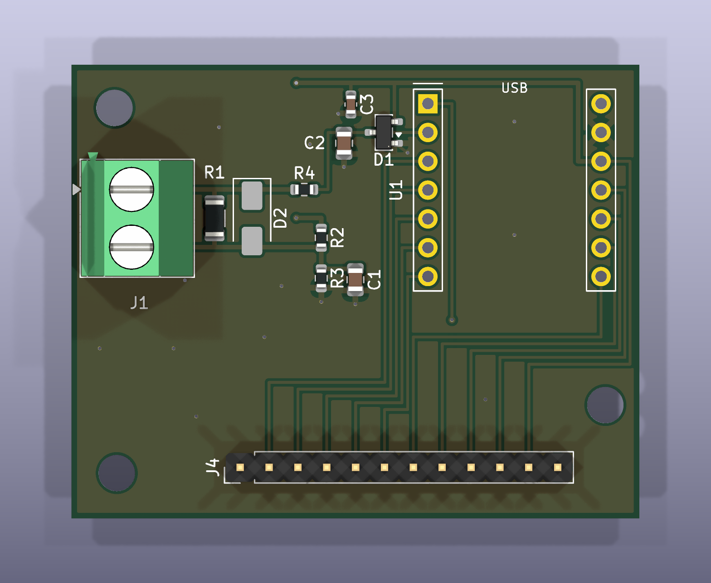
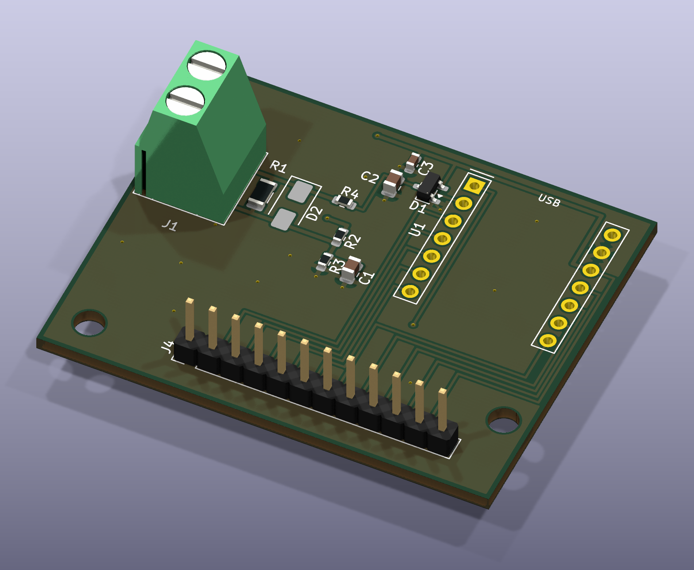

# 生成AI × KiCadで始めるIoTハードウェア開発

**マイコン・センサー・回路図・PCB・ファームウェアを、生成AIと協働して試作するための実践ノート。**

> **ステータス（2026-11-01）：設計デモ / 未実機検証**
> KiCad 10.0.8での回路図作成、PCB配線、ERC/DRCチェックはClaude Codeの作業報告上で完了。一方、計測ファームウェアのコンパイル・実機動作、測定精度、電源OFF時の保護、CT開放時の安全性は未確認です。**製造・工作機械への設置を許可する資料ではありません。**

## このリポジトリで学べること

- Arduino/ESP32などのマイコンとセンサーから、IoT装置の要件を整理する
- **Claude Code + KiCad MCP + KiCad 10** をUbuntuで使う
- AIで回路図を生成しても、**データシート・ERC・ネットリスト・実物のピン配置で検証する**
- シンボル・フットプリントの作成、PCBの部品配置・配線・GNDベタ・DRCまで進める
- ADCのサンプリング、RMS計算、校正、Wi-Fi送信を段階的に実装する
- 再コンパイルによるフットプリント消失など、実際に遭遇した失敗を避ける

## 実例：工作機械向け電流モニター

今回のケーススタディは、**Seeed Studio XIAO ESP32C3 + SR-3704-150N（分割型CT）**による1チャンネル交流電流モニターです。工作機械の加工負荷変化を、電流の時系列として記録することを目標にしています。

**注：** 上の画像はKiCadから書き出されたPCBの可視化であり、製造した実物や通電試験の結果ではありません。XIAO本体・ソケットは画像に含まれません。

| 区分 | 設計・目標値 | 検証状態 |
|---|---|---|
| マイコン | XIAO ESP32C3 / A1 = GPIO3（ADC1） | ピン割当は公式資料と照合したとの報告 |
| センサー | SR-3704-150N、50/60Hz、変流比3000:1、～80A | メーカー納入仕様書を確認 |
| CT負担抵抗 | 10Ω / 1% / 1/4W | 回路上に配置、実測未実施 |
| バイアス | 約1.65V（10kΩ × 2、10µF） | 設計値のみ |
| ADC前段 | 4.7kΩ＋100nF（理論 fc ≒339Hz）、BAT54S | 設計値のみ／保護未検証 |
| 処理 | 約2kサンプル/秒、0.2秒ごとにRMS | **目標**。実機タイミング未検証 |
| PCB | 2層、50×40mm、板厚1.6mm、35µm銅 | KiCad DRC 0件との報告 |
| 通信 | Wi-Fiで記録・可視化 | 将来予定・未実装／未検証 |

## 読み進め方

| 章 | 内容 |
|---|---|
| [01 要件・システム設計](docs/01-system-design.md) | 目的、マイコンの選び方、データフロー |
| [02 開発環境](docs/02-environment.md) | Ubuntu、KiCad、Claude Code、MCP |
| [03 回路設計・部品選定](docs/03-circuit-design.md) | CT、ADC、保護、測定原理 |
| [04 KiCad回路図からPCB](docs/04-kicad-workflow.md) | ERC、フットプリント、配線、DRC、3D |
| [05 計測ファームウェア](docs/05-firmware.md) | サンプリング、RMS、校正、ログ |
| [06 試作・検証計画](docs/06-testing.md) | 低電圧での試験、判定、データ記録 |
| [07 安全・未解決事項](docs/07-safety-open-items.md) | 実機接続前の必須確認 |
| [08 AIへの指示と失敗集](docs/08-ai-prompts-and-lessons.md) | 再利用可能なプロンプト、対処法 |
| [09 GitHub公開手順](docs/09-publishing.md) | ソース移管と公開手順 |

## この配布物に含まれないもの

この文書セットは、会話中の作業ログをもとに再構成しています。Ubuntu上にClaudeが作った **`current-monitor.kicad_sch`、`.kicad_pcb`、`.ino`、BOM CSV、詳細3Dモデルは、この会話には実ファイルとして提供されていないため同梱していません**。GitHubでソースも公開したいときは [移管スクリプト](scripts/import_local_project.sh) を使用し、元のPCから安全にコピーしてください。

## 主要資料

- [Seeed Studio XIAO ESP32C3公式資料](https://wiki.seeedstudio.com/XIAO_ESP32C3_Getting_Started/)
- [SR-3704-150N 納入仕様書（秋月電子掲載PDF）](https://akizukidenshi.com/goodsaffix/SR-3704-150N_20200619.pdf)
- [KiCad 10 PCB Editor公式ドキュメント](https://docs.kicad.org/10.0/ja/pcbnew/pcbnew.html)
- [Claude Code](https://code.claude.com/docs/en/overview)
- [MCP-Kicad（実例で使用したOSS）](https://github.com/unmateria/MCP-Kicad)

> ⚠️ **安全**：CT二次側を開放して一次側に電流を流さないこと。商用・産業用電源の配電盤内作業は設備管理者と適切な資格・権限を有する担当者に依頼してください。AI生成回路のERC/DRC合格は感電・火災・計測精度の保証にはなりません。詳細は [07](docs/07-safety-open-items.md)。
