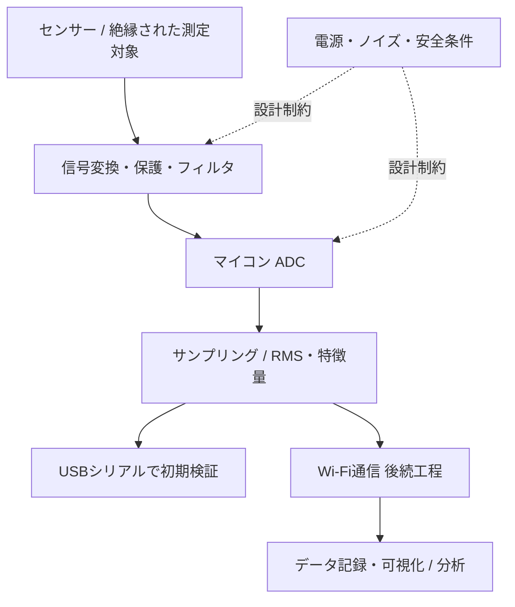

# 01 — 要件定義・システム設計

## 「何を知りたいか」から逆算する

今回の出発点は「工作機械の**加工負荷の変化**を見たい」でした。電流をただ読むことと、加工条件の差や工具摩耗の兆候を識別することは別課題です。

1. **測定目的**：空転・加工・加工負荷の増減を時系列で比較する
2. **対象機械**：マシニングセンタ、旋盤等、機種は未定
3. **測定量**：まず50/60Hzの交流電流の実効値（RMS）
4. **測定条件**：安全な低電圧模擬負荷から開始し、後で電気設備の専門担当者と設置位置を選定
5. **求める判別能力**：例として5A→6Aの差を、繰り返し測定で区別できるか検証
6. **後の拡張**：Wi-Fiによる送信、MQTT、長期トレンド、機械学習による異常検知

## 汎用アーキテクチャ

## なぜXIAO ESP32C3か

- 小型（約21×17.8mm）でWi-Fi・BLE内蔵
- Arduino IDEで扱え、USB Type-Cから書き込める
- ADC1が使えるA1（D1 = GPIO3）を選択できる
- 14ピン2列のピンヘッダー/ソケットを活用し、モジュールごと交換しやすい
- 本体の電源回路・USB回路・無線機能をそのまま利用して、独自PCBの難度を下げられる

一方、低レベルのADCノイズや絶対精度は、専用計測ICに劣る可能性があります。加工負荷を微小な電流変化として読む場合は、外付けADC・増幅器を候補にします。

## どこを測るかは機械に依存する

- **機械全体の入力側**：取り付け対象を探しやすい場合があるが、主軸以外の負荷が混ざる
- **主軸インバータ入力側**：主軸負荷に近づくが、電流波形には高調波が含まれうる
- **主軸インバータ出力側**：PWM成分があり、今回の50/60Hz用CTをそのまま使用しない
- **実際の有効電力・電力量**：CT電流だけでは求められない。電圧・位相・力率に対応した電力計が必要

**原則**：機械への実装場所の選定、盤内作業、設備への適合は有資格・権限者が判断する。本プロジェクトは設計・低電圧試験段階。

## 「成功」の最低条件

回路図ファイルができることではなく、(a)安全な試験系、(b)既知の交流電流に対する再現性、(c)時間変動とノイズの区別、(d)コード・設計の再現可能性、(e)変更履歴の保持が揃うこと。
