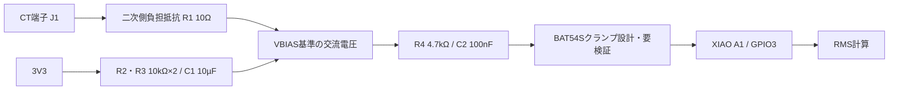

# 03 — 回路設計：CTからXIAOのADCへ

## 使用部品と一次資料

- **SR-3704-150N**：交流用分割型CT。納入仕様書に50/60Hz、最大80A（負荷抵抗10Ω以下）、変流比3000:1、7.5Vツェナーによる開放保護が記載されています。これは仕様書の試験条件に依存します。
- **Seeed XIAO ESP32C3**：D1（Arduino表記A1）= GPIO3 = ADC1_CH3。3.3V系の入力として扱い、5Vを直接GPIOに入れない。

参考：[CT仕様書](https://akizukidenshi.com/goodsaffix/SR-3704-150N_20200619.pdf) / [XIAO公式ピン表](https://wiki.seeedstudio.com/XIAO_ESP32C3_Getting_Started/)

## 1チャンネルの機能ブロック

**ネットの考え方（実配線図ではなく接続要約）**：

- `CT_P` と `VBIAS` の間にR1=10Ωを接続。CT二次側を負担抵抗に並列接続する。
- `3V3 — R2(10k) — VBIAS — R3(10k) — GND`、C1=10µFはVBIAS-GND間。
- `CT_P — R4(4.7k) — ADC_A1`、C2=100nFはADC_A1-GND間。
- D1=BAT54SはADC_A1からGNDおよび3V3側へのクランプ用として設計されたが、**未解決の逆給電リスク**がある。
- D2（TVS）のフットプリントはあるが、**DNP＝未実装**。
- XIAOはUSB給電。`5V`ピンは未接続。

**注意**：J1の片側は`VBIAS`であり**GNDではありません**。試験信号注入の際に混同しないこと。

## 設計値の計算

変流比が3000:1なので、CTの二次実効電流は `I_secondary = I_primary / 3000`。10Ωの負担抵抗を用いると、理想的な正弦波なら

`V_burden,rms = I_primary × 10 / 3000`。

| 一次側の電流 (A RMS) | 負担抵抗の電圧 (mV RMS) |
|---:|---:|
| 1 | 3.33 |
| 5 | 16.7 |
| 6 | 20.0 |
| 10 | 33.3 |
| 20 | 66.7 |
| 80 | 266.7 |

80A時の理想正弦波ピークは約±0.377V。約1.65Vのバイアスに重ねる設計です。上記は**CT特性、周波数応答、ADCの非線形性、バイアスの揺らぎを除外した理論値**です。

## フィルタ

今回の最終回路報告では、R4=4.7kΩ、C2=100nF。

`f_c ≒ 1/(2πRC) ≒ 339Hz`。50Hzの理論振幅通過率は約0.989、60Hzは約0.985です（ほかの負荷を無視）。**1次RCだけでは2kHzサンプリング時のエイリアシングを完全に抑えられません**。広帯域の正確なRMSやインバータ波形の解析には別設計が必要です。

## この回路で重要なリスク

1. **CT開放**：負担抵抗が基板側にあるため、端子が外れるとCT二次側から切断されます。内蔵ツェナーの連続保護能力は未確認。活線状態で脱着しない。
2. **電源OFFの逆給電**：CTからBAT54S経由で3.3V系に電流が入りうる。許容される注入電流・レギュレータへの影響は未確認。
3. **低電流**：5Aで16.7mVrmsしかないため、ADCノイズ・量子化・オフセット・CT誤差を実測で評価する。
4. **部品定格**：R1の定格1/4Wは選定案。CTの異常過渡・負担抵抗断線・温度条件の検証が未実施。
5. **三相/インバータ**：このCTは50/60Hz想定。PWM出力側に安易に設置しない。

**製造に進む前に、独立した電気設計レビューと実機とは切り離した低電圧試験が必要です。**
